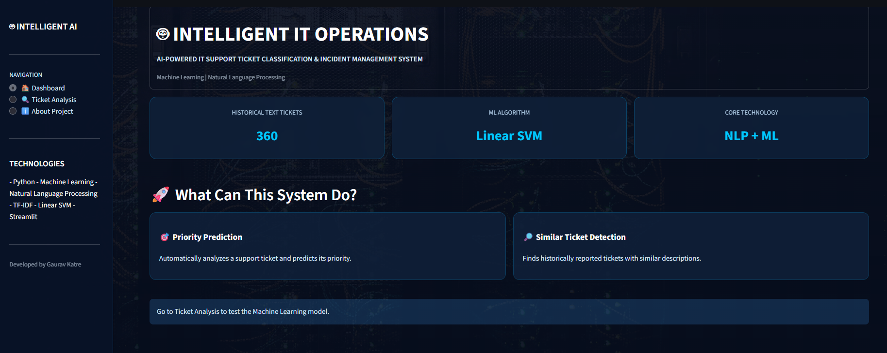

# 🤖 Intelligent IT Operations
### AI-Powered IT Support Ticket Classification and Incident Management System

An AI-powered IT support ticket classification application developed using **Python, Scikit-learn, NLP, TF-IDF, Linear SVM, and Streamlit**.

Intelligent IT Operations is a machine learning project that analyzes IT support ticket descriptions, predicts ticket priority, and identifies similar historical incidents through an interactive web application.

---

## 🌐 Application Preview



*Intelligent IT Operations – AI-Powered IT Support Analytics Dashboard*

---

## 🚀 Project Overview

IT support teams receive numerous technical tickets related to system failures, transaction issues, deployment problems, and application errors.

Manually analyzing and prioritizing every ticket can be time-consuming.

This project demonstrates how Machine Learning and Natural Language Processing can automate ticket priority classification and identify similar historical incidents.

The Streamlit application allows users to:

- Enter IT support ticket descriptions.
- Predict ticket priority automatically.
- Identify similar historical tickets.
- View similarity scores.
- Explore historical ticket information.
- Analyze ticket classification results through an interactive interface.

---

## 🎯 Project Objectives

- Develop an NLP-based ticket classification model.
- Automate IT support ticket priority prediction.
- Apply TF-IDF for text feature extraction.
- Implement Linear Support Vector Machine classification.
- Identify similar historical tickets using Cosine Similarity.
- Build an interactive application using Streamlit.

---

## 📊 Dataset Information

**Dataset:** Help Desk Tickets

**Source:** Mendeley Data

**Dataset Link:** https://data.mendeley.com/datasets/btm76zndnt/3

The original dataset contains approximately 66,691 unique IT support issues.

However, usable ticket descriptions were available for only 360 unique ticket IDs in the modeling dataset.

### Ticket Priority Distribution

| Priority | Number of Tickets |
|---|---:|
| Medium | 155 |
| High | 124 |
| Highest | 51 |
| Blocker | 21 |
| Low | 9 |
| **Total** | **360** |

**Dataset Note:** Model training and evaluation are based on these 360 text-bearing tickets, not the complete set of issues.

---

## 🧠 Machine Learning Approach

The project uses Natural Language Processing techniques to convert ticket descriptions into numerical features and classify their priority.

### Model Architecture

| Component | Technique |
|---|---|
| Text Input | IT Support Ticket Description |
| Text Preprocessing | Lowercasing and Text Cleaning |
| Feature Extraction | TF-IDF Vectorization |
| Classification Algorithm | Linear Support Vector Machine |
| Hyperparameter Tuning | GridSearchCV |
| Similarity Detection | Cosine Similarity |
| Model Pipeline | Scikit-learn Pipeline |

### Model Configuration

- Algorithm: Linear SVM
- Feature Extraction: TF-IDF
- N-gram Range: (1, 2)
- Maximum Features: 5,000
- Hyperparameter Tuning: GridSearchCV
- Cross-Validation: 5-Fold
- Evaluation: Accuracy, Macro F1-score, Weighted F1-score

### Model Performance

The final model was evaluated using a stratified 80:20 train-test split.

| Evaluation Metric | Score |
|---|---:|
| Accuracy | 52.78% |
| Macro F1-score | 0.35 |
| Weighted F1-score | 0.49 |

*Note: These are baseline results from a limited and imbalanced text dataset. Further data collection and model improvements are required for reliable real-world use.*

---

## ✨ Application Features

- Professional IT operations dashboard.
- IT support ticket text input.
- Automated ticket priority prediction.
- NLP-based text preprocessing.
- TF-IDF feature extraction.
- Linear SVM classification.
- Similar historical ticket detection.
- Cosine Similarity matching.
- Similarity score visualization.
- Interactive Streamlit interface.

---

## 🛠️ Technologies Used

| Technology | Purpose |
|---|---|
| Python | Programming Language |
| Pandas | Data Manipulation |
| NumPy | Numerical Operations |
| Scikit-learn | Machine Learning |
| TF-IDF | Text Feature Extraction |
| Linear SVM | Ticket Priority Classification |
| Cosine Similarity | Similar Ticket Detection |
| NLP | Text Processing |
| Joblib | Model Serialization |
| Streamlit | Web Application |
| Matplotlib | Data Visualization |
| Seaborn | Exploratory Data Analysis |

---

## 📁 Project Structure

```text
Intelligent-IT-Operations/
│
├── app/
│   └── app.py
│
├── data/
│   ├── raw/
│   └── processed/
│
├── models/
│   └── final_ticket_priority_model.pkl
│
├── notebooks/
│   └── 01_data_understanding.ipynb
│
├── reports/
│
├── src/
│
├── screenshots/
│   └── intelligent-it-operations-dashboard.png
│
├── requirements.txt
├── README.md
└── .gitignore
```

---

## 💻 Installation and Setup

### 1. Clone the Repository

```bash
git clone https://github.com/gauravkatre55/Intelligent-IT-Operations.git
```

### 2. Navigate to the Project Folder

```bash
cd Intelligent-IT-Operations
```

### 3. Create a Virtual Environment

```bash
python -m venv venv
```

### 4. Activate the Environment

**Windows PowerShell:**

```powershell
.\venv\Scripts\Activate.ps1
```

### 5. Install Dependencies

```bash
pip install -r requirements.txt
```

### 6. Run the Streamlit Application

```bash
streamlit run app/app.py
```

### 7. Open the Application

Open the local URL displayed in your terminal.

Usually:

```text
http://localhost:8501
```

---

## 🔮 Future Improvements

- Increase the number of labeled ticket descriptions.
- Improve classification performance for minority priority classes.
- Experiment with advanced NLP techniques.
- Implement additional machine learning algorithms.
- Add automated ticket category classification.
- Introduce incident trend analysis.
- Evaluate the model using a larger independent dataset.

---

## 👨‍💻 Developer

**Gaurav Katre**

Machine Learning & Data Science Enthusiast

- GitHub: https://github.com/gauravkatre55
- LinkedIn: https://www.linkedin.com/in/gauravkatre/

---

## ⚠️ Disclaimer

This project is developed for educational and portfolio purposes.

The model is an experimental baseline trained on a limited subset of historical ticket descriptions. Its predictions should be reviewed by IT support professionals and should not be treated as definitive incident severity assessments.

---

⭐ If you find this project interesting, consider giving the repository a star!
